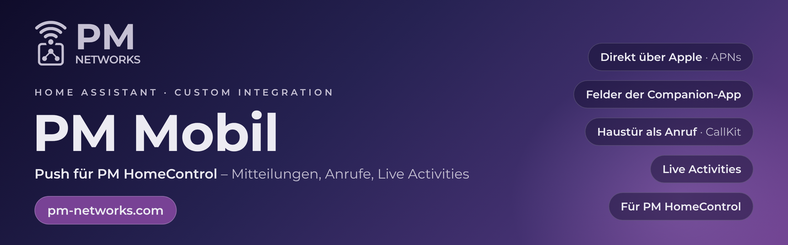

<p align="center">
  <a href="https://pm-networks.com"></a>
</p>

<p align="center">
  <a href="https://pm-networks.com"></a>
  <a href="https://hacs.xyz"></a>
  <a href="https://github.com/PMNetworks/pm-mobil/releases"></a>
  
</p>

# PM Mobil

Integration für Home Assistant, die **PM HomeControl** auf dem iPhone mit Push versorgt: Mitteilungen, Anrufe über
CallKit und Live Activities, direkt über Apple (APNs). Sie ersetzt für PM HomeControl den Relay-Dienst der
Companion-App und versteht dieselben Felder, damit bestehende Automationen mit wenig Aufwand umziehen.

> **PM Networks:** weitere Integrationen und Apps für Home Assistant auf [pm-networks.com](https://pm-networks.com).

## Was PM Mobil kann

| | |
|---|---|
| **Mitteilungen** | `notify.pm_mobil` (alle iPhones) und `notify.pm_mobil_<gerät>` mit den Feldern der Companion-App: `push.interruption-level`, `tag`, `group`, `subtitle`, `url`, `actions`, `image`, `entity_id` (Kamerabild), `clear_notification`. |
| **Kritische Hinweise** | `interruption-level: critical` kommt zeitkritisch und zusätzlich als Anruf „Alarmanlage“. Er klingelt auch bei Lautlos, ohne Sonderfreigabe von Apple. |
| **Haustür als Anruf** | `pm_mobil.anruf` ruft über CallKit an, standardmäßig nur auf iPhones, deren Person unterwegs ist. Nimmt ein iPhone an, hören die anderen auf zu klingeln. |
| **Live Activities** | `pm_mobil.live_activity` und `pm_mobil.live_activity_beenden` mit den Feldern eines typischen `script.live_activity`: Titel, Meldung, Phase, Fortschritt, Farbe, Restzeit, „nur wenn zu Hause“. Sperrbildschirm und Dynamic Island. |
| **Knöpfe in Mitteilungen** | lösen `mobile_app_notification_action` aus wie bei der Companion-App, auch für Benutzer ohne Adminrecht. |
| **Ohne Entwicklerkonto** | Ohne Schlüssel des Apple Developer Program arbeitet PM Mobil lokal: Die geöffnete App zeigt die Live Activities der Automationen, Push kommt mit dem Schlüssel dazu. |

## Installation

[](https://my.home-assistant.io/redirect/hacs_repository/?owner=PMNetworks&repository=pm-mobil&category=integration)

1. HACS → ⋮ → *Benutzerdefinierte Repositories* → `https://github.com/PMNetworks/pm-mobil`, Typ *Integration*.
2. *PM Mobil* herunterladen und Home Assistant neu starten. Updates bietet HACS danach selbst an.

## Einrichtung

[](https://my.home-assistant.io/redirect/config_flow_start/?domain=pm_mobil)

1. *Einstellungen → Geräte und Dienste → Integration hinzufügen → PM Mobil.*
2. Für Push: Team-ID, Schlüssel-ID und den Inhalt des APNs-Schlüssels (`.p8`, aus *Certificates, Identifiers & Profiles
   → Keys* im Apple Developer Program) sowie die Bundle-ID der App eintragen. Ohne Entwicklerkonto die drei Felder leer
   lassen.
3. Optionen: Zonen, die als zu Hause gelten (kein Haustür-Anruf), und ob kritische Mitteilungen zusätzlich anrufen.
4. In PM HomeControl anmelden. Jedes iPhone meldet sich selbst an; es entsteht `notify.pm_mobil_<name>`.

Aus Xcode aufgespielte Apps nutzen die Entwicklungsumgebung von APNs, TestFlight und App Store die Produktion; das
iPhone teilt das bei der Anmeldung mit.

## Beispiele

Klingeln als Anruf (die Klingel-Entität ist ein Platzhalter):

```yaml
triggers:
  - trigger: state
    entity_id: binary_sensor.KLINGEL
    to: "on"
actions:
  - action: pm_mobil.anruf
    data:
      anlass: haustuer
```

Mitteilung mit Knopf und Kamerabild:

```yaml
action: notify.pm_mobil
data:
  title: Haustür
  message: Paket abgestellt.
  data:
    tag: paket
    entity_id: camera.HAUSTUER
    push:
      interruption-level: time-sensitive
    actions:
      - action: PAKET_GESEHEN
        title: Gesehen
```

Live Activity aus einem bestehenden Skript heraus, als zusätzlicher Schritt neben den Companion-Aufrufen:

```yaml
- action: pm_mobil.live_activity
  continue_on_error: true
  data:
    tag: "{{ tag }}"
    titel: "{{ titel }}"
    meldung: "{{ meldung }}"
    stufe: "{{ stufe | default('', true) }}"
    fortschritt: "{{ fortschritt | default(0) }}"
    fortschritt_max: "{{ fortschritt_max | default(100) }}"
    icon: "{{ icon | default('mdi:home-assistant', true) }}"
    farbe: "{{ farbe | default('#2196F3', true) }}"
    restzeit: "{{ restzeit | default(0) }}"
    ton: "{{ ton | default(false) }}"
    nur_zuhause: "{{ nur_zuhause | default(false) }}"
```

Und zum Schließen:

```yaml
- action: pm_mobil.live_activity_beenden
  continue_on_error: true
  data:
    tag: "{{ tag }}"
```

## Ereignisse

| Ereignis | Wann |
|---|---|
| `pm_mobil_anruf` | Ein Anruf ging an die iPhones (Anlass, Kennung, erreichte Geräte). |
| `pm_mobil_anruf_angenommen` | Ein iPhone hat angenommen; etwa um den Türdienst zu übergeben. |
| `pm_mobil_geraet_registriert` | Ein iPhone hat sich zum ersten Mal angemeldet. |
| `mobile_app_notification_action` | Knopf in einer Mitteilung, wie bei der Companion-App. |

## Sicherheit und Datenschutz

- Gesendet wird direkt an Apple; kein Dienst eines Dritten liegt dazwischen.
- Der APNs-Schlüssel bleibt im Konfigurationseintrag von Home Assistant; das Signaturtoken wird alle 40 Minuten neu
  erzeugt.
- Ein iPhone gehört dem Konto, das es angemeldet hat; ein anderes Konto kann es nicht übernehmen. Push-Token werden
  nur als Hex-Zeichen angenommen, ungültige vergessen.
- Bilder für Mitteilungen lädt die App mit dem Zugriffstoken nur vom eigenen Home Assistant, nie von fremden Adressen.

## Lizenz

© 2026 PM Networks. Alle Rechte vorbehalten; proprietäre Software, siehe [`LICENSE`](LICENSE) und
[`AGENTS.md`](AGENTS.md). Die Installation über HACS zur eigenen, privaten Nutzung ist erlaubt; weitere Rechte werden
nicht eingeräumt.
